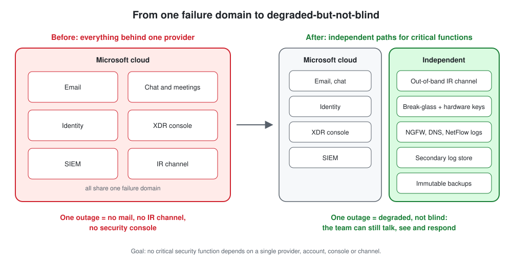
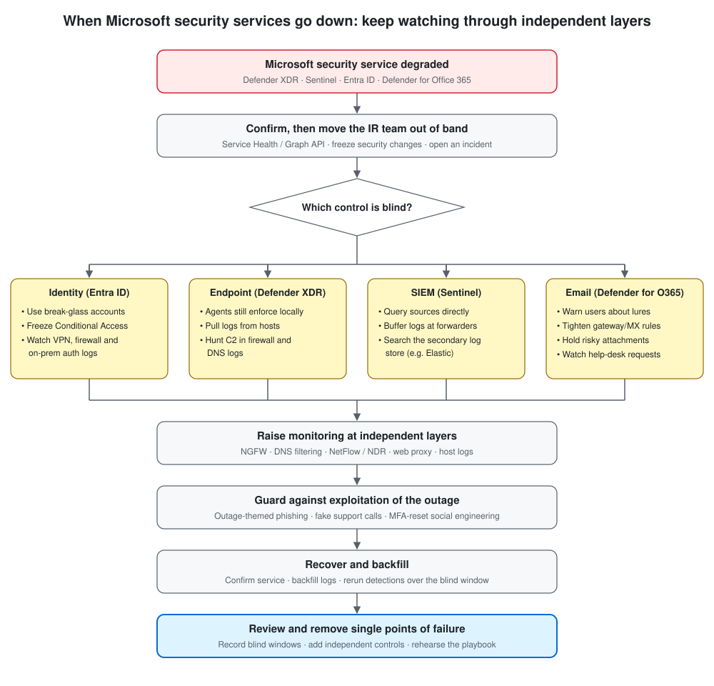
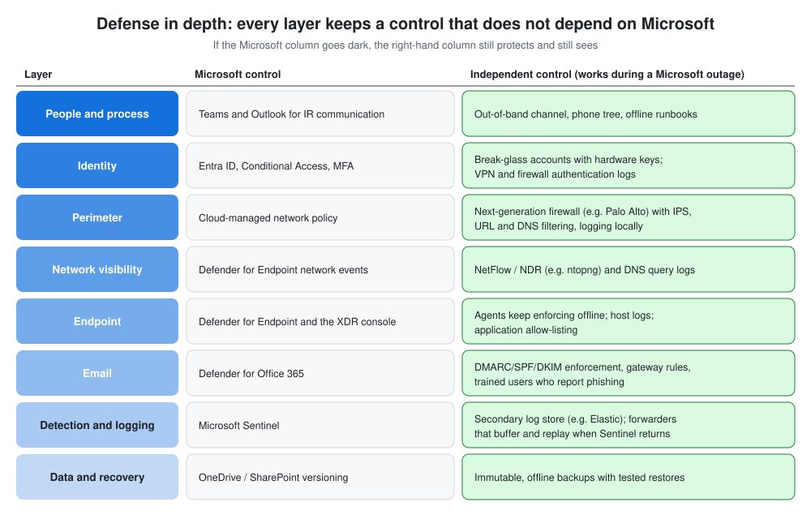

# Microsoft 365 Outage, 12–13 November 2026: Incident Analysis and Customer-Side Playbook

> **Independent, educational analysis.** Based only on Microsoft's public status updates and its preliminary Post Incident Report (PIR) as reported publicly. Microsoft's final PIR (expected around 20 Nov 2026) supersedes anything here. Not affiliated with Microsoft. No tenant data, employer details or real logs are included.

## Summary

For about 24 hours, Exchange Online and the Microsoft 365 services that depend on it were unavailable to many customers worldwide. Outlook, Teams, SharePoint, Copilot and Defender XDR were among the services users reported as affected. Microsoft says the cause was a latent defect, not a cyberattack.

The lesson for customers is not "Microsoft had a bad day." It is: **when your email, chat and security console share one provider, an outage of that provider is also an outage of your incident response.** This repo turns that into a playbook you can rehearse.

| Item | Detail |
|---|---|
| Incidents | EX1550543 (Exchange Online), MO1550821 (Microsoft 365) |
| Impact window (Microsoft's record) | 12 Nov 2026 16:20 UTC to 13 Nov 2026 16:10 UTC, about 23 h 50 min |
| Detection | Connectivity anomaly 16:03 UTC; high-priority alert 16:20 UTC |
| Preliminary root cause | A latent defect in a Windows fix on Microsoft 365 networking gateway servers caused lock contention, exhausting CPU and memory |
| Malicious activity | None, per Microsoft. A **phishing campaign** referencing EX1550543 followed |
| Status | Preliminary PIR dated 15 Nov 2026; final PIR pending |

## 1. What happened (preliminary PIR)

```text
Months-old Windows fix on gateway servers (rolling out since July)
        │  latent defect: lock contention → CPU/memory exhaustion
        ▼
~14% of gateway servers already out of service (unrelated issue, previous day)
        +
Teams traffic failed over ~15 h earlier onto the gateway that also serves Exchange Online
        │
        ▼
Overloaded servers fail → their traffic moves to healthy servers → those fail too
        │  capacity-unit bulkheads did not contain it (separate issue)
        ▼
Defect hit fleet-wide in < 2 h; at worst > 80% of gateway servers unresponsive
```

### Timeline (UTC)

| Time | Event |
|---|---|
| 12 Nov 16:03 | Connectivity anomaly detected |
| 12 Nov 16:20 | High-priority alert; EX1550543 opened |
| 12 Nov 19:06 | Microsoft pauses all deployments and configuration changes |
| 12 Nov 19:18 | Microsoft: load is from many servers being unexpectedly unavailable, not a traffic increase |
| 13 Nov 01:06 | Microsoft: a process establishing secure connections becomes overwhelmed |
| 13 Nov 07:20 | Mitigation applied to part of the capacity |
| 13 Nov ~11:00 | Asia Pacific recovered; Europe healthy by 11:35 |
| 13 Nov 13:00 | Mail queue backlogs start shrinking |
| 13 Nov 14:17 | Global webmail availability back to expected levels |
| 13 Nov 16:10 | Customers no longer actively affected |
| 14 Nov | Microsoft Threat Intelligence reports phishing that references EX1550543 |
| 15 Nov | Preliminary PIR published to administrators |

### Why recovery took a day

- The defect was **months old**, so standard rollback and feature-flag tools could not revert it quickly.
- Exchange Online **could not be moved off** the faulty gateway path, for scale reasons.
- Restarted servers were **immediately flooded** by waiting traffic, so capacity had to return gradually.

### Microsoft's stated repairs (so far)

Connection handling returned to a known-good state; delivery window extended so queued mail was not bounced; extra recovery capacity; more monitoring of traffic redirection and connection health; and new guardrails on traffic distribution to stop cascading failures.

## 2. Lessons for incident responders

| # | Lesson | What it means for your team |
|---|---|---|
| 1 | **The trigger is not the root cause.** The fault shipped months earlier; recent traffic shifts only exposed it. | Correlate incidents against change history over weeks, not hours. Keep change records searchable. |
| 2 | **Failover can spread failure.** Each failed server pushed its load onto the next. | Cap how much load a failover can shift; test bulkheads under degraded capacity, not only full capacity. |
| 3 | **Freeze changes early.** Microsoft paused all deployments within three hours. | Put a change freeze in your outage runbook as an early, pre-approved step. |
| 4 | **Your security tools may share the outage.** Defender XDR was among the affected services. | Know your fallback telemetry, and check SIEM ingestion for gaps afterward. |
| 5 | **Your IR channel may share the outage.** Email and Teams were both down. | Keep an out-of-band channel and a printed or offline contact list. |
| 6 | **Attackers use outages as lures.** Phishing quoted the real incident ID. | Pre-write a user advisory; verify incidents only in the admin center. |
| 7 | **Early status updates are hypotheses.** The early health-check and network-rollback theories were not the root cause in the preliminary PIR. | Label findings as preliminary in your own reporting, and update when the PIR lands. |

## 3. Security view: when the security tools share the outage



Defender XDR, the SIEM, identity and the IR team's own chat channel can all sit behind the same provider. [`SECURITY-RESILIENCE.md`](SECURITY-RESILIENCE.md) covers what to do when Microsoft security services go down, and how to design with defense in depth and no single point of failure:

| Response workflow | Defense in depth |
|---|---|
|  |  |

## 4. What's in this repo

| Path | Purpose |
|---|---|
| [`SECURITY-RESILIENCE.md`](SECURITY-RESILIENCE.md) | Security-focused guide: what goes blind when each Microsoft security service fails, the response workflow, defense in depth and removing single points of failure |
| [`docs/images/`](docs/images) | The three diagrams (SVG) |
| [`PLAYBOOK.md`](PLAYBOOK.md) | Customer-side playbook for a major SaaS/cloud outage: detect, communicate, operate degraded, guard against phishing, recover, review |
| [`queries/kql/`](queries/kql) | Defender XDR / Sentinel hunting queries: outage-themed phishing, SIEM ingestion gaps, post-outage sign-in anomalies |
| [`tools/m365_health_watch.py`](tools/m365_health_watch.py) | Polls Microsoft Graph service health and prints active incidents, so detection does not depend on user tickets. Offline demo mode included |
| [`templates/user-advisory.md`](templates/user-advisory.md) | Ready-to-send user advisory for an outage, including the phishing warning |

### Quick start (offline demo)

```bash
git clone https://github.com/donxud/M365-Outage-Nov2026-IR.git
cd M365-Outage-Nov2026-IR
python3 tools/m365_health_watch.py --sample tools/sample_issues.json
```

## References

- [smtpedia: Microsoft traces the Exchange Online outage to a months-old Windows fix (preliminary PIR summary)](https://smtpedia.com/microsoft-365-outage-root-cause-gateway-windows-defect/)
- [FourWeekMBA: preliminary root cause wording and phishing campaign](https://fourweekmba.com/ai-microsoft-365-root-cause-latent-bug-behind-36-hour-outage/)
- [Microsoft Q&A: update on incident EX1550543](https://learn.microsoft.com/en-us/answers/questions/6070093/please-update-on-incident-ex1550543)
- [DEV Community: Microsoft's status updates in order](https://dev.to/epifive/microsoft-365-outage-nov-2026-what-we-know-about-the-root-cause-and-what-it-admins-should-learn-4hld)
- [RansomNews: affected services and "not a cyberattack"](https://ransomnews.com/microsoft-365-outage-cyberattack-november-2026/)
- [Microsoft Graph: service health API](https://learn.microsoft.com/en-us/graph/api/resources/service-communications-api-overview)

## License

Code under the [MIT License](LICENSE). Incident facts belong to their sources; check Microsoft's final PIR before operational use.
