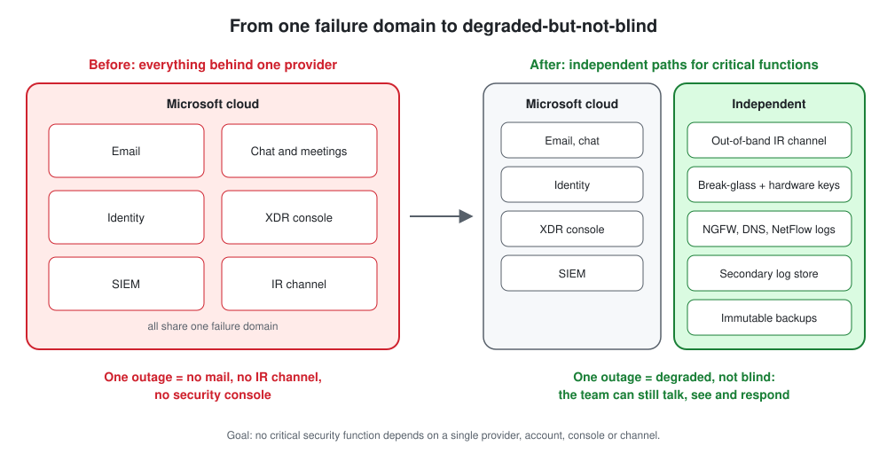
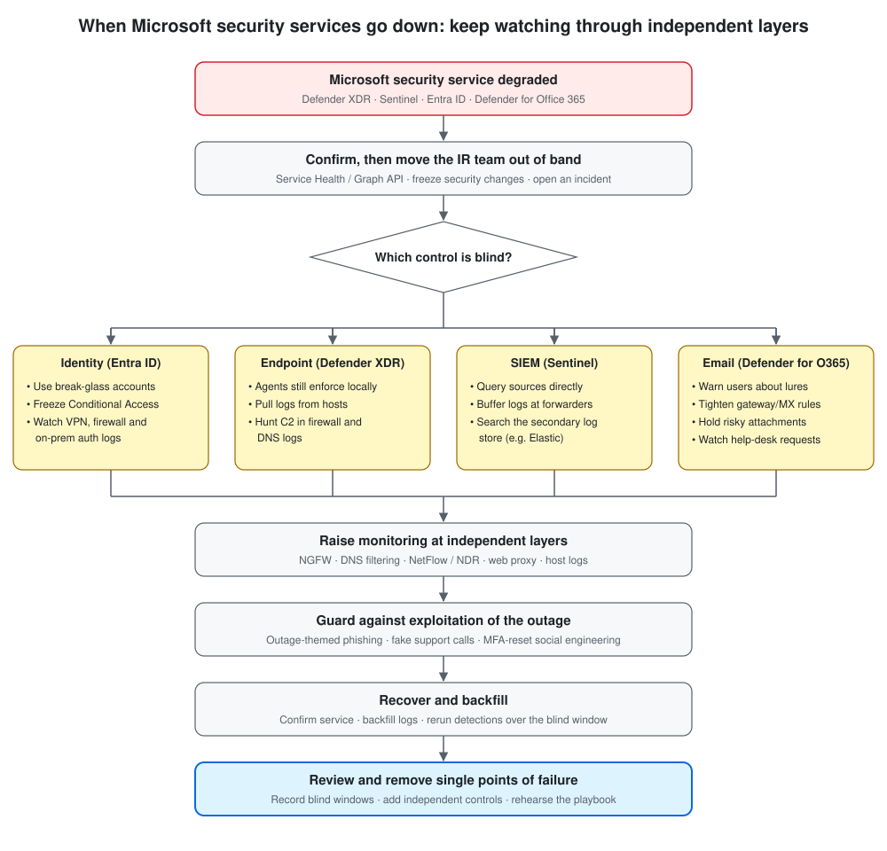
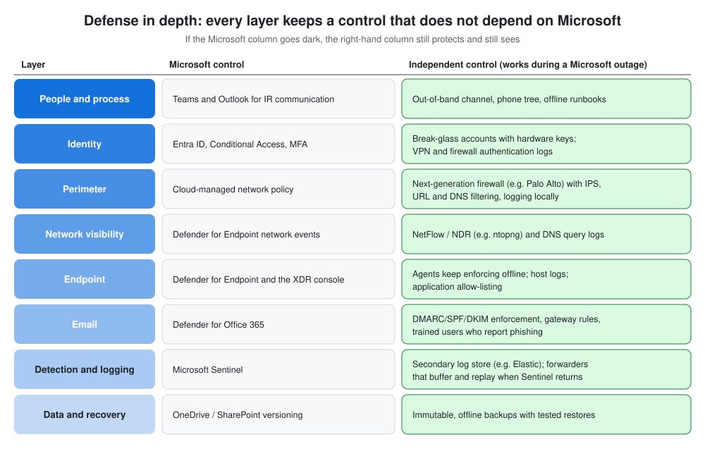

# Security Resilience: When Microsoft Security Services Go Down

The 12–13 November 2026 outage was not an attack, but it showed a security problem: for many organizations, **the mail system, the chat channel the IR team uses, the identity provider, the XDR console and the SIEM all sat behind one provider.** When that provider failed, defenders lost their eyes and their voice at the same moment that attackers started sending outage-themed phishing.

This guide covers what to do during such an outage and how to design so the next one leaves you **degraded, not blind**.

---

## 1. During the outage: response workflow

### What goes blind, and what to use instead

| Service down | What you lose | What still works | Immediate actions |
|---|---|---|---|
| **Entra ID** (identity) | Sign-ins, Conditional Access decisions, sign-in logs | Existing sessions and tokens until they expire; on-prem AD; VPN and firewall authentication | Use break-glass accounts only if needed; freeze CA and MFA changes; watch VPN and firewall auth logs |
| **Defender for Endpoint / XDR console** | Central alerts, investigation, live response, isolation from the portal | Agents keep enforcing their last policy locally; host event logs | Pull logs from critical hosts; hunt command-and-control in firewall, proxy and DNS logs; isolate at the network layer if needed |
| **Microsoft Sentinel** (SIEM) | Correlated detections, hunting, automation | Log sources and forwarders; any secondary log store | Query sources directly; confirm forwarders are buffering; search the secondary store; note the blind window |
| **Defender for Office 365** (email) | Advanced phishing and attachment protection, message trace | DMARC/SPF/DKIM at receiving servers; any gateway in front; users who report | Send the user advisory; tighten gateway rules; hold risky attachment types; watch for outage-themed lures |
| **Teams / Outlook** (IR communications) | The team's normal coordination channel | Phones; the out-of-band channel | Move the IR team out of band; name an incident commander; set an update cadence |

### Rules of thumb

1. **Assume attackers know about the outage before your users do.** Phishing referencing the real incident ID EX1550543 followed this one.
2. **Freeze security configuration changes.** Hurried changes to Conditional Access, mail flow or firewall rules during an outage often outlive it and weaken you.
3. **Write down every blind window**: which control, from when to when. After recovery you must re-run detections over exactly those windows.
4. **Do not lower the bar to restore convenience.** Disabling MFA or Conditional Access "until Microsoft is back" turns a provider outage into your own security incident.

---

## 2. Before the next one: design principles

### Defense in depth

No single layer has to be perfect, because an attacker must get through all of them. The resilience version of that idea is: **every layer should keep at least one control that does not depend on the same provider as the others.**

### No single point of failure

| Single point of failure | How it fails | Independent alternative |
|---|---|---|
| IR communication on Teams/Outlook | Team cannot coordinate when Microsoft is down | Out-of-band channel (Signal group, phone bridge), tested quarterly; offline contact list |
| One identity provider, no fallback | Admins locked out of the very consoles they need | Two break-glass accounts with hardware keys, excluded from dependencies that can fail, monitored for any use |
| One SIEM | No detection, no hunting, no audit trail for the outage window | Forward critical logs to a second store (e.g. Elastic) or keep forwarders that buffer and replay |
| Endpoint visibility only through the XDR console | Cannot see or contain hosts | Network-layer containment (NGFW, NAC); host logs; NetFlow/NDR |
| Email protection only in the provider | Advanced filtering gone during the outage | Enforced DMARC, gateway rules, trained users with a report button |
| Runbooks in SharePoint or OneNote | Playbook unavailable when it is needed | Offline or printed copy; a copy in a separate repository |
| Security automation in one platform | Alerts not routed or enriched | Automation with independent hosting (e.g. Tines) and a direct pager path |
| Backups in the same cloud | Recovery depends on the failing provider | Immutable, separately hosted backups with tested restores |

### Design checklist

- [ ] **Map dependencies.** For each critical security function (detect, investigate, contain, communicate, recover), list the provider, account and console it needs.
- [ ] **Mark functions that share one failure domain** and decide: add an independent path, or accept and document the risk.
- [ ] **Keep network-layer visibility independent**: firewall, DNS and NetFlow logs to a collector you control.
- [ ] **Monitor provider health automatically** (`tools/m365_health_watch.py`) and route it through a path that does not depend on the provider.
- [ ] **Buffer, don't drop**: configure log forwarders to queue during SIEM outages and replay afterward.
- [ ] **Test break-glass accounts** on a schedule, and alert on every use.
- [ ] **Keep the playbook reachable offline.**
- [ ] **Rehearse** with a tabletop: "Microsoft 365 and Defender XDR are down for 24 hours, and phishing referencing the incident is arriving."

### Measures of success

| Measure | Target (set your own) |
|---|---|
| Time to know the provider is down | Before the first user ticket |
| Time to move IR team out of band | Under 15 minutes |
| Critical functions with an independent path | All of detect, contain and communicate |
| Blind windows recorded and re-hunted | 100% after recovery |

---

## 3. Balance and cost

Independence is not free. A second SIEM, gateway or channel costs money and attention, and every extra tool is one more thing to patch and monitor. The aim is not to duplicate Microsoft; it is to make sure **the few functions you need during a crisis**, seeing, containing and talking, survive a single provider failure. Start with the cheapest high-value steps: the out-of-band channel, break-glass accounts, network logs to your own collector, and an offline copy of this playbook.
